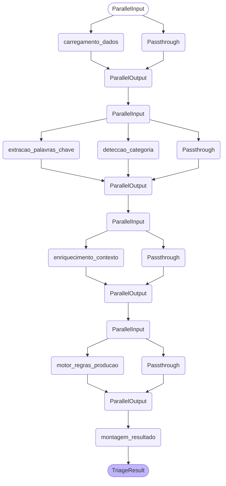
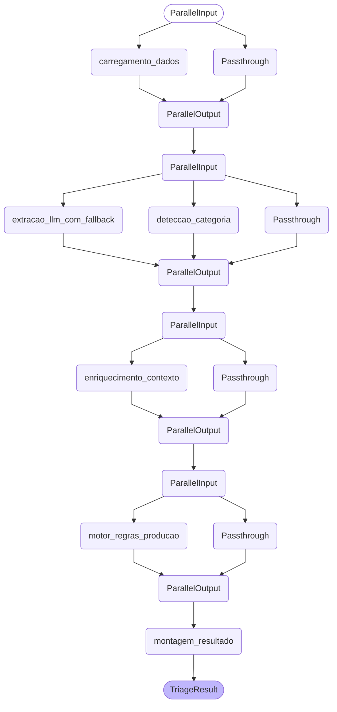
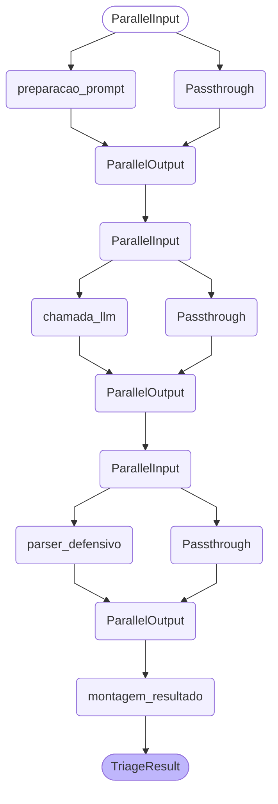

# Fluxos LangChain (LCEL) da triagem

> Arquivo gerado por `python -m src.orchestration`; não editar à mão.
> Protótipo acadêmico — não usar em ambiente industrial real.

Cada fluxo é uma cadeia LCEL composta de Runnables nomeados que trocam um
dicionário de estado. Todos começam com o nó `preparacao_entrada` (marca o início
da medição de latência e prepara o texto) seguido do envelope
`triagem_com_falha_segura`, um `RunnableWithFallbacks`: se qualquer nó do núcleo
lançar exceção, o fallback `resultado_seguro` devolve um resultado com revisão
humana obrigatória. Como o LangChain desenha esse envelope como um único nó opaco,
os diagramas abaixo mostram o núcleo de cada fluxo.

Leitura dos nós gerados pelo LCEL:

- `Parallel<...>Input` / `Parallel<...>Output`: ramos de um `RunnableParallel`,
  criados por `RunnablePassthrough.assign`; os nós entre eles rodam em paralelo.
- `Passthrough`: repassa o estado recebido para ser mesclado às novas chaves.
- `extracao_llm_com_fallback` (só no híbrido): `RunnableWithFallbacks` que executa
  `extracao_llm` e, se ela falhar (erro de parse ou exceção), usa
  `extracao_palavras_chave`.
- `motor_regras_producao`: o motor de regras inteiro, em um único nó; as regras
  continuam declaradas em `data/rules.yaml`.

Os fluxos por regras e híbrido têm a mesma estrutura e diferem apenas no nó de
extração. O cenário-diagnóstico `regras_catref` usa o mesmo grafo do fluxo por
regras (muda só a origem da categoria em `deteccao_categoria`).

## Fluxo por regras de produção

## Fluxo híbrido (neurossimbólico)

## Fluxo LLM puro

